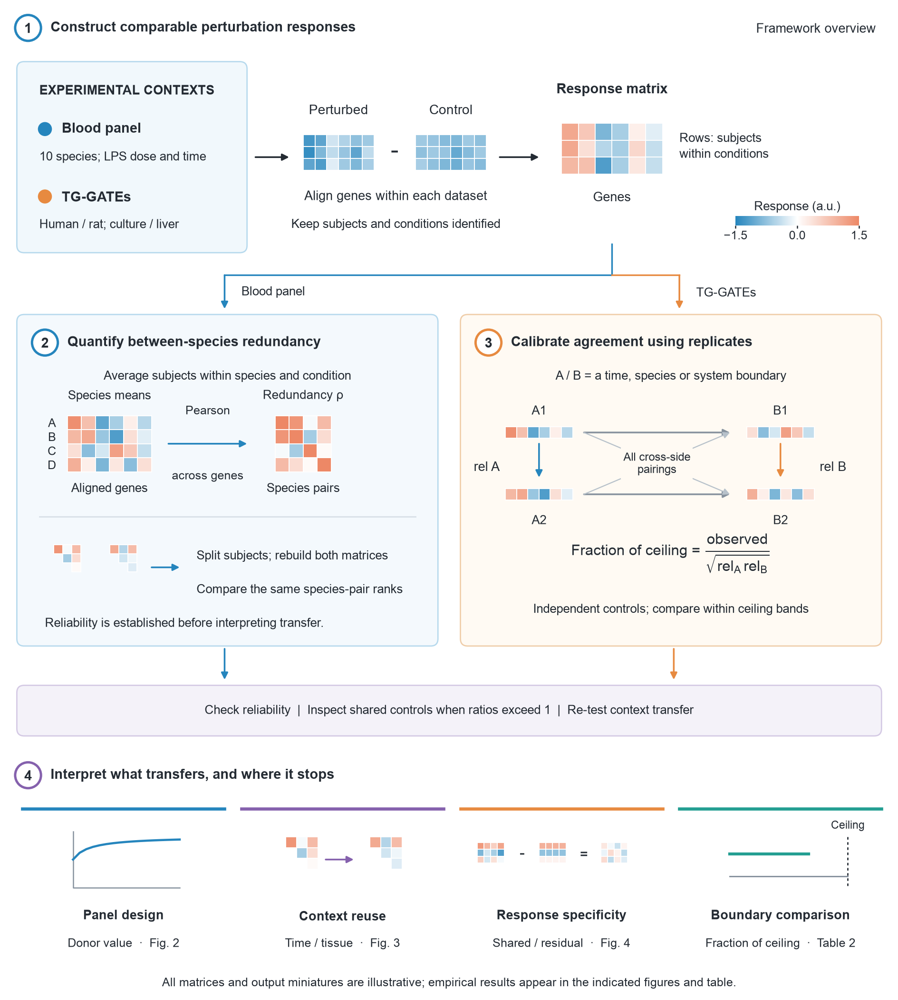
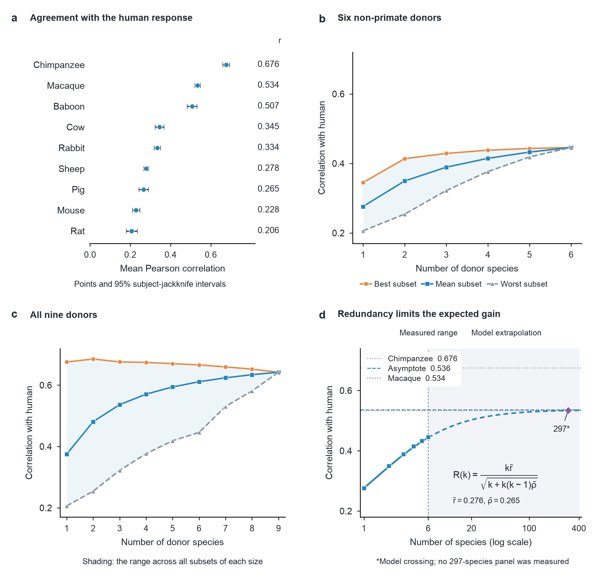
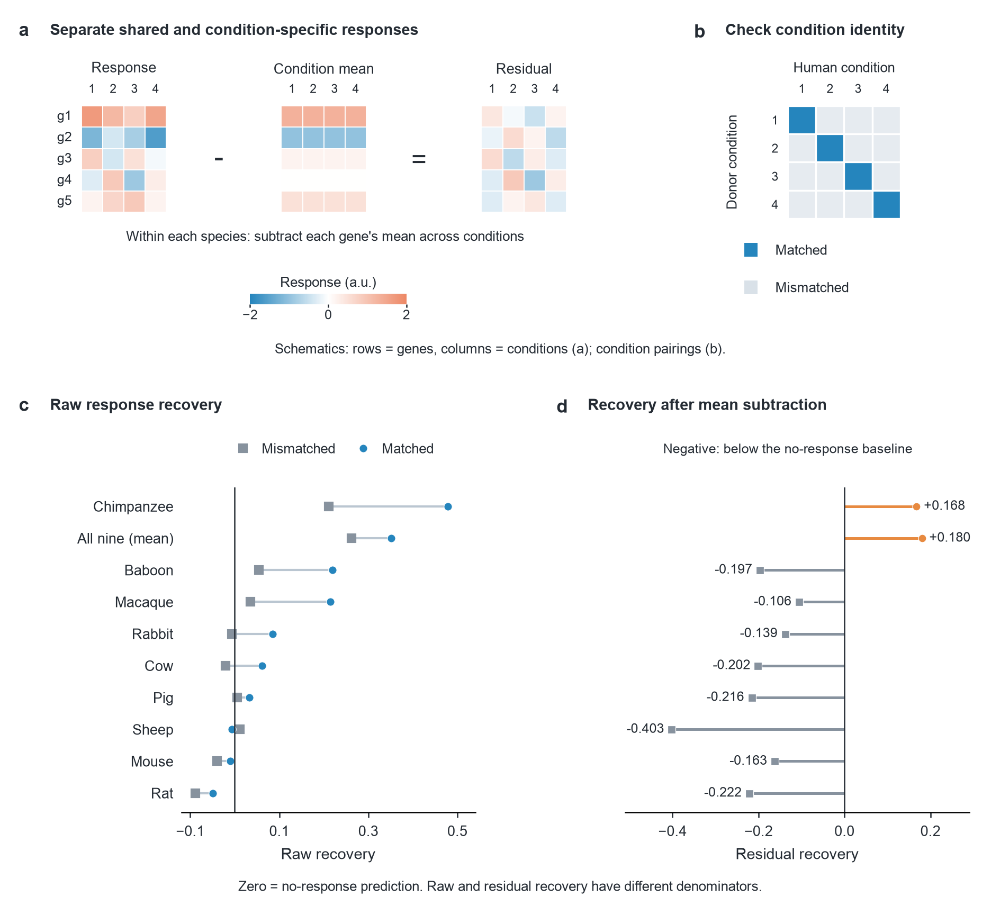

# Reliability and limits of cross-species transcriptomic comparisons

**Preprint — version 2 — 2026-10-26**

**Zihui Zhang^1^, Wei Wang^2^, Ziyan Zhou^2^, Chen Peng^1,\*^, Zhi Wang^2,\*^**

^1^ National Key Laboratory of Veterinary Public Health, College of Veterinary Medicine,
China Agricultural University, Beijing, China

^2^ Beijing Point Eight Intelligent Technology Co., Ltd., Beijing, China

**\*Correspondence:** Chen Peng ([pengchenea@cau.edu.cn](mailto:pengchenea@cau.edu.cn));
Zhi Wang ([witwang@pointeight.ai](mailto:witwang@pointeight.ai)).

**Other author emails:** Zihui Zhang ([18322383991@163.com](mailto:18322383991@163.com));\
Wei Wang ([mojie@pointeight.ai](mailto:mojie@pointeight.ai));
Ziyan Zhou ([zy@pointeight.ai](mailto:zy@pointeight.ai)).

---

## Abstract

Whether a model organism anticipates human biology has been argued for a decade from the same
data, because the quantity that would settle it — how precisely the comparison itself is
measured — is almost never reported. We measure it, and use it to price experimental choices
against one another.

Splitting subjects within each timepoint of a ten-species ex vivo blood panel and recomputing
the species-by-species redundancy matrix gives split-half reliabilities averaging 0.900, 0.947
extrapolated to the full subject set. A failure to transfer becomes a bounded statement rather
than an ambiguous one.

Dividing an observed agreement by what the data's own replicates permit yields a quantity that
cannot exceed one. It did, in three unrelated datasets, every time because treated arms shared
a control set; in the largest, a quarter of all comparisons breached the bound, reaching 2.68.
The construction is therefore also a contamination test, and one that needs no model, because
it reads the design rather than the biology.

On that scale experimental choices become commensurable. With time and dose matched, a
rat-to-human hepatocyte comparison retains 15.2% of its ceiling; a threefold sampling-time
mismatch within one species retains 32–45%, a twelvefold 9–12%. Paired on compound, the
threefold mismatch costs significantly less than the species change and, in rat, the twelvefold
costs more — so aligning time, which is free, outranks the choice of organism. Panels saturate
early: the best two of six livestock and rodent donors reach 77% of the pool's asymptote and
all six reach 83%, and because that asymptote is set by redundancy between species rather than
by effort, the curve a collection will follow can be computed before it is commissioned.

Two results bound what the exchange rate can be used for. What crosses a species boundary is
mostly the response shared across perturbations (r = 0.333) rather than the part identifying
one (r = 0.083); and a cultured profile does not detectably predict organ injury in the animal,
where the in vivo profile does.

---

## 1. Introduction

Whether a model organism anticipates human biology has been contested for more than a decade
with the same data supporting both answers. Seok et al. [1] reported that murine orthologues
matched their human counterparts close to randomly in whole-blood leukocytes (R² between 0.0
and 0.1); Takao and Miyakawa [2], restricting to genes significant in both species, reported
Spearman correlations of 0.43–0.68 with 77–93% agreement in direction; Shay et al. [3]
recovered R = 0.38–0.45 and attributed the difference to time-frame alignment and to the use of
whole blood rather than purified cells. Hagai et al. [4] found significant positive response
correlation in every cross-species pair of matched purified cells. The disagreement is not
about the data. It is about three methodological choices — which genes enter, whether sampling
times are aligned, and what preparation is profiled — none of which is priced.

At the programme level the question has a long-standing empirical answer. Olson et al. [5]
reported true-positive concordance of 71% when rodent and non-rodent data were combined, 63%
for non-rodents alone and 43% for rodents alone; Monticello et al. [6] found the non-human
primate strongest over 182 blinded molecules; Atkins et al. [7] reported median positive
predictive values of 0.60 for monkey against 0.41 for rat. The ordering is settled. What that
literature cannot supply is resolution — a per-gene, per-context quantity in which the cost of
one experimental choice can be weighed against another.

For a panel of species rather than a single pair, the object that carries that resolution is
not a number but a matrix: for a given experimental context, the agreement between every pair
of species' perturbation responses. We write it ρ and call it the redundancy matrix, because
its entries say how much of what one species reports a second species also reports. Matrices of
this shape are reported throughout comparative transcriptomics, and the same object under
another name organises representational analysis in systems neuroscience [24]. How precisely
any particular one of them is measured is a different question, and it is the one left open.
Whether a dissimilarity measure is reliable has been studied in its own right — Walther et al.
[32] compare classification accuracy, Euclidean and Mahalanobis distance and correlation
distance on exactly that criterion — but that is a choice between measures, made once for a
field. The precision of the matrix in hand, in the experiment that produced it, is essentially
never reported beside it. The field's current benchmark of perturbation-response models, eleven
methods over seven datasets, reports neither a noise ceiling nor a reliability normalisation
[61]. Without that number a comparison that comes back low cannot be read: a failure to
transfer and a failure to measure look the same.

A denominator for such a quantity is available. Correcting an observed association by the
geometric mean of the two measures' reliabilities dates to Spearman [8]; Archer et al. [9]
applied exactly this correction to cross-platform expression; systems neuroscience reports
model performance as CC_norm, an observed correlation over a noise ceiling estimated from
repeats [10, 11]; and Zong et al. [12] brought the construction to cross-species
transcriptomics, reporting a median congruence of 0.15 for human against mouse against 0.43 for
human against human. We adopt that denominator and use it for a purpose it has not been put to:
placing time, species and system on one scale so that an exchange rate between them can be read
off. Dose cannot be placed on that scale in these data, for a reason that is itself a result
(Section 2.2).

The measurements rest on five panels. An ex vivo whole-blood panel of ten mammals under
endotoxin carries the reliability, the species ordering and every result about ρ, because it is
the only one of the five with enough subjects per species to split. Human and rat primary
hepatocytes and rat liver in vivo, from TG-GATEs, carry the boundary pricing, because they are
the only arms that hold time, dose and compound fixed while changing one thing at a time. Three
further panels — a five-species hepatocyte panel, bone-marrow-derived macrophages from nine
species, and seven yeasts — test whether the saturation result depends on the first panel.
Section 4 describes them and Section 5 lists their accessions.

We report three things and bound their use. First, how precisely ρ is measured, which is what
makes the rest of the paper decidable. Second, that expressing any agreement as a fraction of
what its own replicates permit yields a quantity that cannot exceed one, so an estimate above
one is a signal about the data rather than about biology; it fired twice here, and both times
the cause was the same. Third, an exchange rate between a species change, a sampling-time
mismatch and the step from culture to animal, read on that common scale. Two negative results
bound what the exchange rate can be used for, and a standalone Limitations subsection states
what the design cannot settle.

---

## 2. Results

Figure 1 gives a standalone overview of the framework. Matched response profiles enter
two complementary calculations: species-pair redundancy with subject-split reliability,
and replicate-based ceilings for comparisons across experimental boundaries. Figures 2–4
then report donor value and panel saturation, context transfer, and response specificity.

**Figure 1.** Workflow for assessing cross-species transcriptomic agreement.
**1**, Perturbation responses are constructed relative to controls on a common gene axis
within each dataset, retaining subject and condition identities. The blood panel comprises
ten species exposed to lipopolysaccharide (LPS); TG-GATEs provides human and rat hepatocytes
and rat liver in vivo. **2**, For the blood panel, species-mean response profiles are
correlated across genes to form the redundancy matrix, ρ. Subjects are split within each
timepoint, both matrices are rebuilt, and the ranks of corresponding species pairs are
compared to establish matrix reliability. **3**, For TG-GATEs boundary comparisons, within-side
replicate response correlations, $\mathrm{rel}_A$ and $\mathrm{rel}_B$, define the ceiling; observed agreement
averages cross-side replicate pairings. Control-disjoint contrasts are compared within
ceiling bands. Ratios above one prompt inspection for sampling error or shared-control
structure (Section 2.2). This profile-level ceiling and matrix reliability are different
constructions. **4**, The framework supports panel design, tests of context reuse and response
specificity, and comparisons of experimental boundaries. All displayed matrices and output
miniatures are illustrative; they are not fitted or measured results. Blue-to-orange matrix
colours denote negative-to-positive values; response matrices use arbitrary units, while
correlation matrices span −1 to +1. Dataset-specific preprocessing and additional
validation panels are described in Methods.

### 2.1 Reliability of the redundancy matrix

Splitting the subjects within each timepoint of the blood panel and computing ρ twice gives the
split-half reliabilities of Table 1. They average 0.900, which the Spearman-Brown extrapolation
[38, 39] to the full subject set raises to 0.947. The 2 h matrix is the least precisely
measured of the three on every reading, so the comparisons that rest on it are the weakest.

**Table 1.** Split-half reliability of ρ: the matrix computed from one half of the subjects
against the matrix computed from the other, within a timepoint. Spearman over species pairs. 45
pairs over ten species, 35 of them spanning different taxonomic orders; the partial removes a
graded taxonomic distance from both sides.

| Timepoint | All 45 pairs | 35 cross-order pairs | Partial on taxonomic distance |
|---|---|---|---|
| 2 h | 0.817 | 0.670 | 0.738 |
| 6 h | 0.955 | 0.926 | 0.945 |
| 24 h | 0.928 | 0.901 | 0.922 |

That number is what makes the blood panel's results decidable. Where ρ transfers there, the
transfer is not an artefact of noise; where it does not, the failure cannot be blamed on
imprecision either. Both directions are used below, and the second is the one that is usually
unavailable. It does not extend to the comparison panels, which carry one sample per species
and so support no reliability of their own — the cross-tissue nulls of Section 2.4 are
undecidable for exactly that reason.

### 2.2 Ceiling normalisation and the exceeds-unity bound

Figure 2a fixes the correlation unit that Sections 2.3, 2.5, 3.1 and 3.2 read values in: for each
donor species, the agreement between its response and the held-out human response in the blood
panel. The scale this section builds is the second one, and it is what Table 2 below uses.

The reliability in Section 2.1 is a special case of a construction that applies to any
comparison; Svensson et al. [62] score perturbation-response models against a half-sample
reference ceiling of the same family. Here it is applied to experimental boundaries rather than
to models, and built on donors rather than cells, because a cell split approaches unity as
sequencing depth rises and leaves no asymptote below one to read. For each perturbation we
compute the correlation between two sides across genes, and divide it by the same statistic
computed between replicates within each side:

$$
\text{fraction of ceiling} = \frac{\text{observed}}{\sqrt{\mathrm{rel}_A\,\mathrm{rel}_B}}
$$

The population quantity cannot exceed unity, so an estimate above it is either sampling error
in the two replicate correlations or structure shared between the two sides before any biology,
and the quantity doubles as a diagnostic. That a shared reference can manufacture correlation
between arms that have none is a known failure mode of normalisation [54], and it is the one
these data turned out to have. It fired on the dose contrasts in two unrelated datasets and, in
both, the mechanism was confirmed directly: the dose arms at one timepoint are referenced to a
shared control set (one experiment identifier covering all four arms in 145/145 and 143/143
compounds). Between two and thirty-eight compounds per dose contrast exceed the bound, to a
maximum of 1.97. Those contrasts are excluded throughout.

A third dataset was brought in to test the construction rather than to be analysed, and there
the breach is not marginal. In LINCS L1000 Phase 2, 948 plates each carry a median of 20
control wells against 350 treated, so every treated well on a plate is referenced to the same
small control set. Predicting one cell line's response from another's over 1,785 compounds, 471
of the 1,912 units for which a ceiling can be formed exceed it — a quarter of them — reaching
2.68 against a bound of one. The geometry that produces this is visible in the plate layout
before any statistic is computed, which is the case for the diagnostic: it detects a property
of the design, not of the biology, and it needs no model to do so.

Because the fraction of ceiling tracks its own denominator (Spearman +0.665 against the
ceiling, +0.544 against response amplitude, n = 123), rows are compared only inside a fixed
ceiling band.

**Table 2.** Fraction of ceiling retained, read from compounds whose ceiling falls in the band
[0.60, 0.78). TG-GATEs human and rat primary hepatocytes and rat liver in vivo; gene-level
Pearson; median over compounds, both columns read inside the band. The shuffle-corrected column
subtracts what a randomly paired compound yields.

| Change | % of ceiling | Shuffle-corrected | n |
|---|---|---|---|
| rat liver in vivo, 24 h vs 9 h | 52.6 | 36.5 | 38 |
| rat liver, single 24 h vs repeat 4 d | 51.6 | 35.2 | 36 |
| human hepatocyte, 24 h vs 8 h | 44.8 | — | 41 |
| rat liver in vivo, 24 h vs 6 h | 42.2 | 27.0 | 43 |
| rat hepatocyte, 24 h vs 8 h | 32.0 | — | 34 |
| rat liver in vivo, 24 h vs 3 h | 25.6 | 13.0 | 37 |
| **species, human vs rat hepatocyte** | **15.2** | **7.5** | 38 |
| human hepatocyte, 24 h vs 2 h | 12.4 | — | 20 |
| rat hepatocyte, 24 h vs 2 h | 9.0 | — | 53 |
| **system, dish vs animal (time matched)** | **8.6** | **1.6** | 61 |
| species and system together | 3.5 | 0.8 | 51 |

A threefold mismatch in sampling time costs less than a species change; a twelvefold mismatch
costs more. Because the table's rows are medians over partly disjoint compound sets, we test
that ordering on compounds measured on both sides. Pairing on compound, the threefold mismatch
retains 20.5 percentage points more of its ceiling than the species change in rat hepatocytes
(114 of 129 compounds, sign test p = 5 × 10⁻²⁰) and 24.2 points more in human (124 of 129, p =
8 × 10⁻³¹); restricted to compounds inside the band on both sides the same contrasts give +17.3
(16 of 19, p = 0.004) and +23.3 (18 of 18, p = 8 × 10⁻⁶). The twelvefold mismatch reverses: in
rat it retains 7.7 points less than the species change (35 of 129, p = 2 × 10⁻⁷; in band −8.5,
3 of 15, p = 0.035), and in human the 47 shared compounds give −2.3 points and do not resolve
it (p = 0.24). The system row is the one that needed the single-dose in vivo arm, sampled at 3,
6, 9 and 24 hours, to overlap the in vitro grid. Read as medians it sits below the species row,
8.6% against 15.2%. **That ordering does not survive the test we have just applied to the
others.** On the sixteen compounds measured inside the band on both sides, the paired
difference is +0.8 points with 8 of 16 favouring the system change, sign test p = 1.00. We
therefore report the two medians and state that the dish-to-animal step and the species step do
not separate in these data, rather than ordering them.

### 2.3 Saturation with panel size

**Figure 2.** Donor value, panel composition and the limits of pooling. **(a)** Mean
across-gene Pearson correlation between each donor species and the held-out human response,
over nine endotoxin conditions in ex vivo blood (25,638 genes). Points and horizontal bars
show estimates and 95% stratified leave-one-subject-out jackknife intervals. Absolute values
are low by 0.022 to 0.062 under the missing-value convention of Section 3.2. **(b, c)** Best
(orange circles), mean (blue squares) and worst (grey triangles) equal-weight subsets at each
size, enumerated among the six non-primate donors and all nine donors, respectively. Shading
is the full range across subsets, not an uncertainty interval; both panels share the same
vertical scale. **(d)** The exchangeable-predictor expectation R(k), using measured mean
donor–human r̄ = 0.276 and donor–donor ρ̄ = 0.265 for the six non-primate species, assumes unit
variances and equal pair correlations. Blue squares are measured subset means. The grey
region and dashed curve mark extrapolation beyond the six available donors. Horizontal
references show the pool asymptote (0.536), one macaque (0.534) and one chimpanzee (0.676).
The diamond marks the analytic crossing at k = 297, not a measured panel; this crossing
disappears on the filtered gene axes of Section 2.5. All empirical panels use the same nine
conditions and gene axis.

What a new species adds depends on how much of its response the species already in the panel
carry, so the saturation curve (Figure 2) is a consequence of the matrix measured in Section
2.1.

Increments to the best panel are +0.069, +0.015, +0.009, +0.005 and +0.003: the first step
falls 4.5-fold and each step after that roughly halves. In the full nine-donor pool the best
panel peaks at two species and declines monotonically thereafter. The saturation result does
not rest on this panel alone: it replicates in four further panels, two of which — the FAANG
macrophages and the yeasts — contain neither primates nor human. The other two do, so that part
of the replication is not independent of the primate contrast.

For a homogeneous pool the measured curve follows the equal-weight form for k exchangeable
predictors,

$$
R(k) = \frac{k\bar{r}}{\sqrt{k + k(k-1)\bar{\rho}}},
\qquad \lim_{k\to\infty} R(k) = \frac{\bar{r}}{\sqrt{\bar{\rho}}},
$$

where r̄ is the mean correlation between a donor species and the human target and ρ̄ the mean
off-diagonal entry of ρ. The form is an expectation over panels of size k and therefore
describes the average panel, not the best one. The form itself is classical: Kelley [29] gives
it as the correlation between a criterion and an equally weighted sum of k scores, with the two
parameters entering as the mean score-criterion and mean inter-score correlations, and takes
the same k → ∞ limit; Gulliksen [30] states that limit as a decision rule for whether
lengthening a test can raise its validity. Kelley reads it as the correlation between the
criterion and the true score the components share, which is the one-sided correction for
attenuation — so the asymptote here and the ceiling of Section 2.2 are one construction seen
twice. An accuracy equation of the same shape is used to combine sources in genomic prediction
[31], there for two sources and with no ceiling set by the correlation between them. This
section adds the measurement rather than the form: ρ̄ estimated for cross-species perturbation
responses, carrying the reliability of Section 2.1. Fitted against the average panel it gives a
residual sum of squares of 3.0 × 10⁻⁵ over six points at r̄ = 0.276 and ρ̄ = 0.265; scored
instead against the best panel of each size — a quantity it does not claim — the same fit
returns 1.2 × 10⁻², which is worse than a horizontal line (7.3 × 10⁻³). The asymptote is 0.536,
with a leave-one-subject-out standard error of 0.021. A single chimpanzee reaches 0.676, above
that asymptote, so no equal-weighted panel drawn from this pool reaches its level at any size.
A single macaque reaches 0.534, within one standard error of the asymptote, so these data do
not place it on either side: the gap is +0.0025 with a paired interval of [−0.034, +0.039]. The
six species together reach 0.446, 83% of their own asymptote, and adding all six to one macaque
buys +0.0086.

The fit degrades sharply on a heterogeneous pool: including a chimpanzee raises the residual
sum of squares against the average panel from 3.0 × 10⁻⁵ to 5.5 × 10⁻³ over nine points, a
factor of 186. This is expected, since exchangeability is the form's premise.

Panel size does buy insurance (Figure 2b, c), though the two readings below come from different
pools and the narrowing is not monotone in either. In the nine-donor pool the spread between
the best and the worst panel of a given size narrows from 0.431 at k = 2 to 0.071 at k = 8. In
the six collectible species it is non-monotone, rising from 0.139 at k = 1 before falling, so
the guarantee rather than the spread is the usable statement: in an unfamiliar context, where
the best donor is unknown, a single-species choice ranges from 0.345 to 0.206 depending on the
guess, while the full six-species panel reached 0.446, the one value it can take in this pool.

### 2.4 Reuse of the matrix across contexts

**Figure 3.** Matrix reliability and transfer across contexts. **(a)** Illustrative
upper-triangle matrices, matched-pair vectors and a rank plot show how matrix agreement is
computed. Self-correlations and duplicate pairs are omitted. Purple outlines identify pair
A–C; the rank plot's diagonal denotes equal ranks. **(b)** Measured split-half reliability
within each blood timepoint. **(c)** Measured agreement between blood timepoints. Numbers
and heatmap colours encode Spearman coefficients; the three columns use all pairs,
cross-order pairs, and partial correlation after removing ranked taxonomic distance.
Panels (b) and (c) use 45 species pairs, including 35 cross-order pairs. **(d)** Blood–macrophage
agreement over ten shared pairs, six cross-order, shown for both estimators: pooling profiles
before correlation, or correlating within conditions and then averaging. Grey circles,
blue squares and purple diamonds correspond to the three analyses in (b, c). All empirical
panels use the current two-estimator analysis. Asterisks mark nominal one-sided p < 0.05 under
species-label Mantel permutations, without multiplicity adjustment. Neither cross-order
blood–macrophage estimate is significant. The blood–hepatocyte comparison is reported in the
text; its four cross-order pairs fall below the Methods floor of five.

Because the entire saturation curve is a function of ρ, the redundancy matrix is the object
worth transferring. Raw matrix agreement is supported between neighbouring blood timepoints;
the largest time gap lacks support after taxonomic controls, and cross-tissue transfer remains
unestablished. The blood–macrophage comparison (Figure 3d) depends on which of two estimators
is used, and their cross-order signs disagree, so we report both.
Pooling conditions before computing ρ gives Spearman +0.333 between blood and macrophage over
all ten shared pairs (Mantel p = 0.203); computing ρ inside each condition and averaging gives
+0.503 (p = 0.035). Under the cross-order restriction the two part company: +0.371 for the
per-condition estimator and −0.086 for the pooled one, neither significant. The
blood–hepatocyte comparison reaches +0.60 over six pairs but at p = 0.337, so it does not
support a transfer claim before any restriction is applied. The absolute level also shifts
between contexts (mean 0.343, 0.420 and 0.307), so each context requires its own measurement in
any case. We draw no positive cross-tissue conclusion from these numbers.

An ordering of species pairs invites the objection that it restates a phylogeny, and the
objection has to be answered with pairs whose relatedness is matched. The objection has weight:
taxonomic relatedness is the basis of a deployed regulatory tool, the US EPA's interspecies
correlation estimation models, built from 780 models over 77 aquatic species and more than 550
chemicals, in which same-family surrogates predict within fivefold of the measured value 91% of
the time [41]. It also has a counterweight from the same field: across 36 datasets, Coleman and
Edmands [42] found a strong phylogenetic signal in only 9, with no attribute shared by those
nine. Neither study measures what we measure — both read a single acute endpoint in aquatic
animals, where this paper reads a transcriptome-wide response in mammals — so they bound how
far the objection generalises rather than settling it. The blood panel can supply them. Its
preparation subtracts a no-LPS control matched to each subject and timepoint, so the three
timepoints are control-disjoint and serve as three contexts across all ten species: 45 pairs,
35 of them spanning different taxonomic orders. Restricted to those 35, and again with a graded
taxonomic distance partialled out of both sides, two of the three comparisons survive a Mantel
null (Figure 3c, Table 3). The third survives neither: 2 h against 24 h falls to +0.084
restricted and +0.262 partialled, at p = 0.374 and 0.122.

About half of this matrix is not pair-specific at all. Writing each entry as a per-species
level plus a pair interaction, the additive part accounts for 44.5%, 47.1% and 56.2% of the
off-diagonal variance at 2, 6 and 24 hours. Removing it by double-centring and repeating the
three comparisons, all three now pass under the cross-order restriction, and pass again with
the graded taxonomic distance partialled out of both sides, so the three do not pass merely
because double-centring removed the part that carries relatedness. Table 3 gives both matrices
side by side.

The reason is not that the additive part fails to transfer. Measured directly it transfers
rather well, at Spearman +0.855, +0.600 and +0.794 across the three timepoint pairs, which is
better than the interaction manages. The mixture is what changes: the additive share rises from
44.5% to 56.2% and the spread of the per-species levels nearly doubles, because by 24 hours the
two rodents have fallen away from everything else — mouse from 0.401 to 0.072 and rat from
0.361 to 0.121, where the chimpanzee moves only from 0.461 to 0.310. When two components are
summed and their relative weight shifts between contexts, the sum reproduces itself across
contexts less well than either component does on its own. Double-centring removes that shift in
weight; it does not remove a defect.

This buys a narrower and firmer statement than the raw matrix supports. The pair-specific
structure — which is the object a catalogue would sell, since the per-species level is one
number and the structure is the matrix — reuses across all three contexts here, including the
change of regime. The per-species level also reuses, but its scale does not, so the two should
be carried separately rather than as one matrix.

**Table 3.** Agreement between timepoint redundancy matrices before and after
double-centring. Spearman over species pairs with a one-sided Mantel p beneath; 45 pairs,
35 cross-order. Raw rows use `rho_cross_panel_both_estimators.json`, as in Figure 3;
double-centred rows use `rho_double_centred.json`. Both use average ranks for tied taxonomic
distances. Each row's p-values come from its own permutation run. Minimum attainable
Monte Carlo p-values are rounded to 5 × 10⁻⁵ or 2.5 × 10⁻⁴; they indicate simulation resolution.

| Matrix | Comparison | All 45 pairs | 35 cross-order | Partial on taxonomy |
|---|---|---|---|---|
| raw | 2 h vs 6 h | +0.684 (p = 5 × 10⁻⁵) | +0.515 (p = 0.020) | +0.581 (p = 0.0022) |
| raw | 2 h vs 24 h | +0.438 (p = 0.028) | +0.084 (p = 0.374) | +0.262 (p = 0.122) |
| raw | 6 h vs 24 h | +0.848 (p = 1 × 10⁻⁴) | +0.707 (p = 0.014) | +0.813 (p = 0.0012) |
| double-centred | 2 h vs 6 h | +0.878 (p = 5 × 10⁻⁵) | +0.749 (p = 1 × 10⁻⁴) | +0.849 (p = 2.5 × 10⁻⁴) |
| double-centred | 2 h vs 24 h | +0.717 (p = 5 × 10⁻⁵) | +0.417 (p = 0.009) | +0.643 (p = 2.5 × 10⁻⁴) |
| double-centred | 6 h vs 24 h | +0.879 (p = 5 × 10⁻⁵) | +0.755 (p = 5 × 10⁻⁵) | +0.851 (p = 2.5 × 10⁻⁴) |

The comparison that fails on the raw matrix is the one that spans the largest gap, and it fails
for a reason we had already measured elsewhere in these data. Agreement does not decay smoothly
with elapsed time: 6 h against 24 h, a fourfold gap, retains more than 2 h against 6 h, a
threefold gap. The early timepoint behaves as a regime of its own, which the TG-GATEs
hepatocyte series shows independently — 24 h against 8 h retains 45% of ceiling and 24 h
against 2 h only 12%. These data therefore establish something narrower than reuse across
contexts in general. Raw matrix agreement is supported between neighbouring blood timepoints,
but not across the largest time gap after taxonomic controls; its pair-specific part retains
agreement across all
three.

The same restriction applied across panels leaves six and four cross-order pairs, and nothing
survives it under either estimator. For blood against macrophage the per-condition estimator
gives +0.371 restricted and +0.103 partialled, the pooled one −0.086 and −0.313, none
significant; the blood–hepatocyte comparison retains four cross-order pairs, too few for a
correlation we report, and computed on exactly those four it returns −0.400 (p = 0.788). Both
comparison panels carry one sample per species and so admit no reliability estimate of their
own. A failure to transfer therefore cannot be separated from a failure to measure. The
within-panel result establishes reusability within a context family; reusability across tissues
remains open, and the measurement that would settle it needs donor replication in a new
comparison panel rather than more species.

### 2.5 Controls on the species ordering

Two alternative explanations predict the same ordering as biology does, and both were tested on
the data in hand. The first is annotation quality. A species whose genome is annotated less
well maps fewer genes onto the shared human axis; the unmapped positions enter as zeros, so its
log fold changes compress toward zero and correlate less with anything. Because annotation
quality tracks how much a species has been studied, it also tracks relatedness to human, and so
predicts the same ordering biology does. Restricting to genes detectably expressed at rest in
all ten species removes that channel by construction. At thresholds retaining 6,477, 5,372 and
2,973 genes the ordering is unchanged (Spearman +0.98, +0.97 and +0.98 against the full-axis
ranking) and every value rises, chimpanzee from 0.676 to 0.857 and rat from 0.206 to 0.357.
Annotation does carry part of the premium — the primate to non-primate ratio falls from 2.07 to
1.66 — but it does not carry the ordering.

The second is measurement precision, since a species with a small response relative to noise
correlates poorly with anything. The raw ordering does track response amplitude at Spearman
+0.93, which is why the test is needed. Dividing by each species' own split-half reliability,
the normalisation this paper applies everywhere else, leaves the ordering intact at Spearman
+0.967; mouse and rat reliabilities are 0.81 and 0.78, mid-pack among the nine, so their
position is not an artefact of measurement.

Figure 2a carries stratified leave-one-subject-out intervals, standard errors 0.007 to 0.014.
Overlap between two intervals is not a test, so the ordering was checked by a paired jackknife
on the difference, which separates 33 of the 36 species pairs: cow against rabbit, sheep
against pig and mouse against rat do not separate. The tiers are resolved and the ordering
inside a tier is not.

The same gene sets were carried to the saturation curve, since the pricing argument rests on a
gap of 0.0025 between the asymptote and one macaque while filtering moves every correlation by
about 0.15. Both parameters move together: r̄ rises from 0.276 to 0.408, 0.428 and 0.454 while
ρ̄ rises from 0.265 to 0.391, 0.408 and 0.429, so the asymptote rises more slowly than the
macaque's level does and the gap goes from +0.0025 to −0.0257, −0.0162 and −0.0092. On every
filtered set the collectible pool's ceiling sits below one macaque rather than above it, and a
paired jackknife over 36 subjects separates only the first: −0.0257 [−0.050, −0.001], −0.0162
[−0.041, +0.008] and −0.0092 [−0.031, +0.013], against +0.0025 [−0.034, +0.039] on the
unfiltered axis. That conclusion rests on the filtered axes alone. On the unfiltered axis,
where the quantity was first computed, the gap has the opposite sign, and Section 2.3 declines
to place the macaque on either side. As the filter tightens, the margin shrinks monotonically,
and still does after normalising by the headroom each gene set leaves (−8.0%, −5.2%, −3.1%).
Tighter filters leave fewer genes and widen intervals, which explains the interval width but
not the drift of the point estimate toward zero, for which we have no explanation.

### 2.6 Consensus and perturbation-specific components

**Figure 4.** Separating common and condition-specific responses in the blood panel.
**(a)** Illustrative gene-by-condition matrices: subtract each species' across-condition mean
from every condition to obtain its residual. All three matrices use the same scale, from
−2 (blue) to +2 (orange), in arbitrary units. **(b)** An illustrative pairing map distinguishes
matched donor–human conditions (blue diagonal) from mismatched conditions (grey off-diagonal).
Four conditions are shown schematically; the empirical analysis uses nine. **(c)** Measured
matched recovery (blue circles; mean over conditions) and mismatched recovery (grey squares;
median over different-condition pairings), connected within each donor row. Segments compare
scores and do not indicate uncertainty. **(d)** Recovery after mean subtraction on both sides,
with rows aligned to (c); orange circles denote positive estimates and grey squares negative
estimates, without implying significance. Stems connect each estimate to zero. Recovery is
1 − SSE/Σy²: zero is the no-response prediction and negative values are worse than that
baseline. The statistic is unbounded below; the residual target changes the denominator,
so magnitudes in (c) and (d) are not comparable. Only the chimpanzee and the nine-species
equal-weight mean retain positive residual recovery.

What crosses a species boundary is mostly the response shared across perturbations rather than
the part that identifies one. Splitting a perturbation profile into a shared component and a
compound-specific residual is not new: Szalai et al. [51] show that signatures of cell death
and proliferation dominate perturbation transcriptomics generally, and frameworks for
evaluating perturbation-response models now separate the shared from the specific as a matter
of course [52]. What is new here is the quantity, measured across a species boundary and
against a shuffled control. We decompose each profile into its projection on the
across-compound consensus and the residual. In TG-GATEs hepatocytes the consensus transfers
between species at r = 0.333 and the compound-specific residual at r = 0.083. Pairing a
compound's human profile against a different compound's rat profile recovers 43% of the matched
agreement. At the dish-to-animal boundary even less of the agreement is compound-specific: 87%
of it survives shuffling the compound pairing. Both percentages are taken over all shared
compounds, where Table 2's two columns are in-band medians, so the two are not the same ratio
and should not be differenced.

The blood panel uses a direct subtraction of each species' across-condition mean
(Figure 4a), giving the pattern in Figure 4d. As its caption explains, the sign is
interpretable, while raw and residual recovery magnitudes are not comparable. After the
across-condition consensus is removed, only the chimpanzee and the nine-species mean remain
positive.

### 2.7 Prediction of organ injury from cultured and in vivo profiles

With serum alanine and aspartate aminotransferase from the same rats whose livers were
profiled, a leave-one-compound-out similarity predictor was run at every combination of three
endpoints — ALT, AST and their maximum — and three injury thresholds, 1.5, 2 and 3-fold over
vehicle. The in vivo profile predicts in all nine: AUC 0.675 to 0.895, permutation p ≤ 0.045
throughout, and above the permutation null's 95th percentile in every setting. The bootstrap
intervals are wide at the strict thresholds, where positives are few: the weakest setting, ALT
at 3-fold, gives 0.675 with a 95% interval of 0.425 to 0.903 over eight positives, so that
setting alone would not establish the result, while the strongest, AST at 3-fold, gives 0.895
[0.755, 0.993] over nine. The result rests on the nine settings agreeing in direction rather
than on any one of them. The hepatocyte profile does not, in all but one of them: 0.411 to
0.672 from rat, 0.311 to 0.443 from human and 0.317 to 0.508 when the two are averaged, so
adding the human arm to the rat arm does not help. Aggregating to 3,244 Gene Ontology
biological process terms does not change it either. Of the forty-five deposited hepatocyte
comparisons — those three arms by nine endpoint-and-threshold settings, plus the rat and human
arms aggregated — exactly one clears its own null: rat hepatocytes against a 3-fold AST rise,
0.672 against a 95th percentile of 0.659. Read as a direct association rather than as a
classifier the answer is the same: the human-against-rat hepatocyte fraction of ceiling
correlates with log2 serum ALT at Spearman +0.010 across the 123 compounds carrying both (p =
0.91, 95% interval −0.17 to +0.19).

That negative is a bound, and the deposited runs state how loose. The permutation null's 95th
percentile runs from 0.594 to 0.677 as the positive count falls, so an AUC below roughly 0.60
at the loosest threshold and 0.68 at the strictest cannot be distinguished from chance by
construction, and every hepatocyte value lies in that range. Power was obtained by loosening
the label rather than by improving the design: the usable positives are 29, 13 and 8 for ALT at
1.5, 2 and 3-fold, so the strictest and most clinically meaningful threshold is also the least
able to detect anything. The endpoint is itself a maximum over four sacrifice days by three
dose levels, twelve cells with no correction, and its own reliability is 0.381 across animals,
0.552 extrapolated, so a perfect predictor reaches about 0.743 in these units. The in vivo
result survives all of that; the in vitro negative is consistent with a real absence and with
an effect this design could not see. A null at this boundary is not new: Thomas et al. [21]
reached the same conclusion from high-throughput in vitro screening against in vivo hazard, and
Natsoulis et al. [22] had already shown that the liver's xenobiotic response repertoire is
low-dimensional enough that many signatures with no genes in common classify equally well.
Chierici et al. [57] reach a comparable bound on the predictability of drug-induced liver
injury by machine learning. The literature is not unanimous, and the positive results are worth
naming: a transcriptomics- derived gene space has been reported to predict liver injury
accurately [58], and in vivo short-term exposure models predict long-term outcomes well [60].
Our negative is specific to the cultured arm, and Section 2.7's own bound says how loose it is.

Most of the in vivo signal is carried by response magnitude alone (AUC 0.762 for the L2 norm of
the response vector), which is statistically indistinguishable from the 5,000-dimensional
similarity model at 0.742 given 35 positives. A deliberately simple predictor matching a far
richer one is the pattern in perturbation-effect prediction too: Ahlmann-Eltze et al. [59]
found that none of five foundation models and two further deep-learning models outperformed
simple linear baselines, and the approach that did win there was itself linear. Neither result
licenses the stronger claim that high-dimensional structure carries nothing; both say it was
not needed here. The in vivo result is not an artefact of dosing near the tolerated limit: it
survives removing dose (0.766 to 0.754) while dose does not survive removing the transcriptome
(0.600 to 0.562, no longer significant).

## 3. Discussion

The measurements above convert a long-standing qualitative dispute into a set of priced
choices. The species ordering they reproduce is not new: it has been reported at the programme
level for twenty-six years [5–7] and at the transcriptome level for thirteen [1]. The exchange
rate between a species change and the other experimental choices has not previously been
stated, and it is the quantity an experimentalist actually faces. Shay et al. [3] identified
time-frame alignment as decisive without quantifying it; Sutherland et al. [13] decomposed
concordance variance and found sampling time dominant with dose contributing almost nothing;
Zong et al. [12] state the alignment rule but select the best-matched timepoint and discard the
rest, which removes the cost of getting time wrong by construction. Table 2 supplies that cost.

A chimpanzee sits above the reachable ceiling of a livestock-and-rodent pool, and chimpanzee
research is closed by law in the two jurisdictions that funded most of it. The US listed all
chimpanzees as endangered in 2015 (80 FR 34499 [25]) and NIH ended support for biomedical
research on them that November; Directive 2010/63/EU Art 8(3) [26] states that great apes shall
not be used in procedures. Supply of the macaque, the next most informative donor, is
constrained by the same kind of fact rather than by cost [27].

A programme that plans to accumulate species is accumulating along the axis whose analytic
ceiling lies below unity — replicates asymptote to one, species to r̄/√ρ̄ — and that ceiling is
set by ρ̄ rather than by effort. Since ρ̄ can be measured before a collection is commissioned,
the two numbers that describe a panel's curve could in principle price that panel before it
exists — for a pool homogeneous enough for the form to hold, and on a fixed gene axis, both of
which these data show matter. We have not tested that use prospectively, and of everything
reported here we expect it to be the part most often used.

The decomposition in Section 2.6 is the result with the widest implications and the one most in
need of further work. El-Hachem et al. [14] reported the qualitative phenomenon on the same
resource, noting that the chemicals associated with a module show no meaningful overlap across
systems or species while pathway-level conservation does, and called the dissociation
counterintuitive. Our contribution is to quantify that consensus-to-specific ratio and to find
it larger at the dish-to-animal boundary than at the species boundary — 87% against 43% of the
matched agreement surviving a shuffled pairing — a difference we report without an interval on
it. If the component that carries perturbation identity is the component that does not
transfer, then cross-species extrapolation will remain informative about whether a response
occurs and uninformative about which perturbation produced it. The same shape appears wherever
a model is asked for the specific rather than the average. Sequence-to-expression models
predict the across-individual mean expression of a gene well and the variation between
individuals poorly [47–49], which is the same dissociation between a consensus and the part
that identifies a case. The sbv IMPROVER species-translation challenge reached it from the
other direction: across its entries, inter-species prediction succeeded at the level of pathway
and gene-set activity and failed at the level of the individual phosphorylation or expression
response [43–45], and a model trained to carry mouse inflammation signatures into human had to
learn which genes translate rather than assume them [46]. Where the specific component is
wanted, simple controls have repeatedly matched or beaten the models built to recover it [50].
Section 2.7 is what that would look like functionally, though these data do not show that the
failure there is carried by the component that does not transfer.

Our ordering of the dish-to-animal step against the species step is contested in the
literature, and the two studies that bear on it disagree with each other. O'Donovan et al.
[20], training convolutional models on the same resource, report mean absolute errors of
0.0377, 0.0304, 0.0285 and 0.0246 for rat in vitro to rat in vivo against 0.0214, 0.0174,
0.0184 and 0.0166 for rat in vitro to human in vitro across four gene sets, so the
dish-to-animal task costs 48% to 76% more error than the species task, which agrees with Table
2. Liu et al. [18] order the two boundaries the other way, on 131 TG-GATEs compounds. The same
group reports elsewhere [19] that rat in vitro and rat in vivo systems resemble each other more
than either resembles a second species: rat primary hepatocytes against rat 28-day in vivo
liver reach a pair-ranking score of 0.71 — a high extrapolation potential, in their terms —
against 0.58 for human primary hepatocytes against the same in vivo reference. They conclude
that species difference plays the critical role.

What separates their measurement from ours is not the data, which is the same. Their statistic
is second-order, preserving the rank ordering of compound pairs, where ours is a gene-level
correlation; there is no reason the two should order the same boundaries. Their comparison also
carries a 24-hour against 28-day gap where ours is read at a matched 24 hours, and neither of
their contrasts is divided by a ceiling, so any difference in the reliability of the two in
vitro arms passes straight into the result. We do not claim our reading settles the ordering:
as reported above, the two boundaries do not separate under our own paired test. The
disagreement between O'Donovan and Liu therefore stands, and this work narrows it only by
supplying a common denominator, not by resolving it.

Finally, the boundary that matters most for translation remains unmeasured. Every comparison
here holds at least one side in culture, or compares an animal to itself. A living animal
against a living human under a matched protocol is, to our knowledge, unmeasured at
transcriptome scale, and the human side of such a comparison exists in public data [15–17, 28].
We regard closing it as the decisive next experiment and state in Section 3.3 the readings that
would support or refute the framework.

One premise of all of this can be checked on somebody else's work, and we checked it. Svensson
et al. [62] publish their model and their data, so we ran them. Their reported baseline
reproduces to within rounding on their own held-out context — mean Pearson Δ 0.4515 against the
0.46 of their repository, PR-AUC 0.4034 against 0.40 — and we then changed one thing. Their
model represents an unseen perturbation as a weighted combination of the perturbations in a
panel, so we drew that panel from a single response cluster instead of at random, leaving the
model, the data, the held-out context and the panel size untouched. Mean Pearson Δ fell from
0.5600 to 0.5127 and the significant-gene Spearman from 0.5987 to 0.5158, and in both the four
clustered panels lie entirely below the four random ones, which themselves span 0.020. The
fourth metric, PR-AUC, overlaps. Their model is stable across the panels it was reported on;
what moves is the score, and it moves with a choice the report does not record.

The construction of Section 2.2 then says something about their system that their own metric
cannot. Their panel carries twelve donors for every cell type and cytokine, so the response can
be measured against what the other eleven donors already imply: leave one out, average the
rest, correlate across genes, in exactly the unit and over exactly the 744 observations they
score. That consensus reaches 0.4315, and their reported 0.4515 is 105% of it.

A ceiling measured this way is conditioned on the donors collected: a larger panel would give a
better consensus and a higher ceiling, so the number would mean little if it were still
climbing at twelve. It is not. Rebuilding the consensus from two donors upward on four cell
types, the ceiling rises about 0.11 in total and then flattens, the step from eleven donors to
twelve falling between −0.010 and +0.001 against points that each average twelve random draws.
The donor-level headroom on this panel is therefore spent, and spent at a level more donors
would barely move.

It is also not bought down by sequencing more. Section 2.2 builds the scale on donors rather
than cells on the argument that a cell split rises towards one with depth where a donor split
does not, and this panel lets the donor half of that be measured instead of argued. Each of its
1,619 (cell type, perturbation) units records the number of cells behind it, and those counts
span 2 to 3,074. Pooled across the panel, cell count and ceiling correlate at Spearman +0.785 —
which is the wrong comparison, because an abundant cell type has both more cells and a higher
ceiling for reasons that are about the cell type. Within a cell type, where that is held fixed,
the median correlation across the eighteen is +0.08. A thousandfold difference in depth does
not move the ceiling. What it reflects is variation between donors, which is why the
denominator has to be built on them. A model with no access to a given donor is competing with
that donor's peers, theirs already edges past them, and what is left unexplained is
donor-specific variation that no amount of further modelling on this panel can reach. Their own
thesis is that observed statistics suffice; measured against the ceiling, they do.

The same calculation shows why a bare score is so hard to read. Across their eighteen cell
types the ceiling runs from 0.032 to 0.577, an eighteenfold range, so the same model evaluated
on a different cell type would post a wholly different number while being neither better nor
worse. Most of what separates those numbers is the data, not the model. This is a weaker
statement than the bound of Section 2.2 and must not be read as that bound: a donor consensus
is a particular predictor rather than a mathematical limit, and a model that has learned from
other contexts may legitimately exceed it, as this one does. What it bounds is the information
a panel holds about a donor it has not seen.

The same dataset settles what a whole-cluster holdout costs. At thirteen times the compound
count the cost reproduces closely: ridge regression loses 0.016 to 0.017 at three cluster
granularities. What does not reproduce is a reversal of verdict, because here the model leads a
predictor that ignores its input by a factor of three, 0.168 to 0.178 against 0.045 to 0.050,
and a cost of that size cannot cross a margin that wide. On our own smaller panel the baseline
reached most of the model's performance and the same cost did cross it. The quantity that
generalises is therefore the degradation, and what decides whether it changes a conclusion is
the margin the model had to begin with — which is why a score reported under one split says
nothing about whether that margin would survive extrapolation, and why both splits and the
trivial baseline have to be reported together. We had earlier read the two splits as giving
opposite verdicts; that reading was too general, and this is the measurement that narrowed it.

### 3.1 Implications for study design

1. **Align sampling time across arms before adding an arm.** A threefold mismatch in sampling
   time costs less than a species change, and an order-of-magnitude mismatch costs more than a
   species change in rat hepatocytes, though the human contrast did not resolve. Alignment is
   free.
2. **Most of what a well-chosen panel buys arrives by the second species.** The best two of the
   six reach 77% of the pool's asymptote and all six reach 83%, so the four after the second
   buy six points between them. Read on the average panel of each size instead — which is what
   the analytic form describes, and what a chooser without prior knowledge gets — two reach 65%
   and the remaining four buy eighteen points, so this is a rule about a well-chosen pair
   rather than about any pair. Whether to pay for the rest is a budget question, not a
   measurement one. **How to choose the second species we cannot yet answer, and our two panels
   disagree.** Spreading across the sequence-identity spectrum reached the enumerated optimum
   at every size tested in the five-species hepatocyte panel while picking the most human-like
   species did not; in the blood panel the ordering reverses, with top-identity ahead of spread
   from k = 2 to 5 (0.515 against 0.480 at k = 2). We report both rather than the one that
   suits the rule.
3. **Report a matrix, not a rate — and carry its two parts separately.** About half the matrix
   is a per-species level and half a pair structure; the structure reuses across a change of
   regime where the raw matrix does not, and the level reuses in rank but not in scale. The
   marginal value of a species depends on the panel it joins: adding rodents to a primate arm
   loses 0.006 while adding the same rodents to a livestock arm gains 0.035, and the gain from
   the third species added to a rodent pair varies ninefold with which species it is.
4. **Buy replicate depth, not breadth, when precision is the goal.** Replicates within a
   species asymptote to unity; species asymptote to r̄/√ρ̄, which is below unity.
5. **Never split a panel by dose.** Dose arms at one timepoint share a control set, and two to
   thirty-eight compounds per resulting contrast then exceed a ceiling that cannot be exceeded.
   This is one instance of the leakage that arises whenever units that share preprocessing are
   split across a boundary [55].

Rule 2's percentages of the asymptote and rule 3's cross-context statements are correlations,
in the unit of Figure 2a. The panel-composition figures inside those two rules — the marginal
values in rule 3, and the enumerated optima in rule 2 — are instead computed on a recovery
statistic, 1 − SSE/Σy² (the squared error against the sum of squares of the target, taken about
the origin rather than about its mean). That statistic is unbounded below, and its differences
and rankings depend on predictor scale, so those figures describe these two panels rather than
naming quantities with an absolute meaning. We are not the first to name the defect: Miller et
al. [53] report across fourteen datasets and eighteen metrics that squared-error-family scores
are frequently miscalibrated and insensitive to real differences in model performance. Rules 1,
4 and 5 do not use it.

Two of these rules carry a qualification that belongs beside them. Rule 1 prices time in
fold-mismatch, but agreement does not decay smoothly with it: in the blood panel a fourfold gap
retains more than a threefold one, because the two-hour timepoint behaves as a regime of its
own. The day-scale in vivo contrasts break the pattern in the same way. Where this paper writes
"a threefold mismatch" or "an order-of-magnitude mismatch" it is naming particular contrasts,
not evaluating a function of fold change.

Rule 2, for its part, endorses what practice already does. Prior et al. [23] document that
regulatory programmes already run two species, typically rat with dog or rat with a non-human
primate and mouse third; a rule that says stop after the second is not a change to any real
programme. Its operative half — how to choose the second — is the half our two panels disagree
about.

### 3.2 Limitations

**Scope.** Five panels — blood, five-species hepatocyte, FAANG macrophage, TG-GATEs and yeast —
four mammalian and one fungal; three mammalian tissues, whole blood, bone-marrow-derived
macrophages and liver; three perturbation classes. The five-species hepatocyte panel supports
no reliability ceiling at all, having one replicate per cell, and contributes design rules
rather than priced boundaries. The TG-GATEs arms are male rats of a single strain, one organ.

**The main blood panel supplies fewer independent contexts than conditions.** Its nine
conditions are three doses by three timepoints, and dose arms at one timepoint share a control
set; by our own disjointness rule it supplies roughly three independent contexts. The
saturation result does not rest on this panel alone: it replicates in four further panels
(Section 2.3).

**That panel is ex vivo.** Blood is drawn and then stimulated, so both sides of the comparison
are in a tube. An ex vivo panel is therefore not a cheap stand-in for the living-animal
comparison this framework most needs.

**Whole blood confounds cell-type composition with cell-intrinsic response, and the reference
we cite for the opposite point raises it.** An expression change measured in whole blood is a
weighted average over leukocyte populations whose proportions differ markedly between these
species — human blood is neutrophil-dominated where mouse blood is lymphocyte-dominated — so
part of any cross-species difference is a difference in the mixture rather than in the
programme any cell runs. Shay et al. [3], cited in Section 1 for time-frame alignment, make
exactly this argument against whole blood. The partial answer we can offer is weak and
estimator-dependent: the ρ ordering agrees between ex vivo whole blood and purified
bone-marrow-derived macrophages at +0.503 over all shared pairs on the per-condition estimator
(p = 0.035) but only +0.333 on the pooled one (p = 0.203), and a pure composition artefact
would not obviously produce even the weaker of these. It is not a full answer, because neither
estimate survives the cross-order restriction.

**The three timepoints come from one experiment and one set of subjects.** They are different
contexts by our own decay measurements — across cross-order pairs 2 h and 24 h retain under a
tenth of ρ's reliability between them, against roughly half for 2 h and 6 h and three quarters
for 6 h and 24 h — but they are a weaker separation than two tissues profiled in two
laboratories.

**Missing values are carried as zeros in the blood panel, which depresses every absolute
value.** The pipeline that delivered it converts the tokens NA, empty and null to TPM 0.0, and
19.9% of the delivered matrix carries one, so a gene never measured is indistinguishable
afterwards from a gene measured at zero. The affected fraction differs by species, from 14.2%
for macaque to 32.3% for rabbit, and those genes contribute a constant zero to every contrast,
which dilutes a correlation without biasing its rank. Rebuilding the responses with the cells
masked instead raises every species by 0.022 to 0.062 and leaves the ordering at Spearman
+0.983, the single swap being cow against rabbit, a pair the paired jackknife already cannot
separate; the primate premium moves from 2.07 to 2.00. So the ordering is unaffected and the
absolute levels reported here are low by a species-dependent amount, including the levels that
count against the framework. We leave the figures on the zeroed convention because changing one
panel's convention would detach it from the rest, and record the bias instead.

**Any human data in hand outranks any animal here, and the manuscript's framing should not
obscure it.** A held-out human condition predicted from that same human's average over its
other conditions reaches 0.816 in the correlation unit Figure 2a uses, against 0.676 for the
chimpanzee and 0.642 for the nine-species equal weight. The same comparison in the recovery
statistic gives 0.631, 0.479 and 0.352; we quote the correlation because the recovery statistic
is unbounded below and unfit for rankings (Section 3.1), and the ordering is the same
either way. The nine conditions are doses and timepoints of one stimulus, so this is an upper
bound on what human-to-human transfer would achieve against a genuinely new perturbation; it is
nonetheless the correct reference point for a paper whose purpose is pricing animal data
against human data.

**No multiplicity adjustment is applied anywhere, and the family is large.** Section 2.4
reports three comparisons under two tests each, Section 2.5 reports thirty-six simultaneous
pairwise tests, Section 2.7 reports nine endpoint-and-threshold settings per arm, and the
paired sign tests of Section 2.2 add eight more. We report nominal p-values throughout and name
the family here rather than adjust, because the comparisons are neither independent nor
exchangeable and any single correction would misstate one of those two facts. Readers treating
any individual p near 0.05 as decisive should discount accordingly; the results we rest on —
the reliability, the two surviving cross-time comparisons at p ≤ 0.02, and the paired
time-versus-species tests at p < 10⁻⁶ — do not depend on that discount.

**Inside the band the normalisation is nearly inert, and its work in Table 2 is selection
rather than rescaling.** The band is narrow enough that the median ceiling is 0.678 to 0.695 on
every row, so dividing by it is close to dividing by a constant: within the band the fraction
of ceiling is a near-monotone transform of the raw correlation, at Spearman 0.986 for the
species row, 0.996 for the system row and 0.959 to 0.987 for the time rows. Table 2 is
therefore, to within rank noise, a table of raw correlations on a matched-quality subset. We
state this plainly because the alternative reading — that the disattenuation is what makes the
rows comparable — is not supported. The ceiling's contribution to Table 2 is the subset itself:
without computing it one cannot know which compounds have comparable measurement quality. Its
load-bearing uses are elsewhere and are not inert: the exceeds-unity diagnostic, the
reliability of ρ, and the ρ analyses of Section 2.4, none of which is band-restricted.

**The ceiling band is a choice, and it does not remove the dependence it was introduced for.**
Rows are compared only inside [0.60, 0.78) because the fraction of ceiling tracks its own
denominator. The band narrows that dependence without removing it: on the species row the
residual in-band Spearman between the fraction and the ceiling is +0.317 over the 38 in-band
compounds, against +0.682 over all 129. The placement itself was chosen to retain a usable
number of compounds on every row rather than by a stated criterion, and we report no sweep over
alternative placements. The twelvefold time-versus-species reversal is the result most exposed
to this, since it is the one that first becomes significant inside this band.

**The blood panel's gene axis is not ours and carries no one-to-one restriction.** Its 25,638
columns are human Ensembl gene identifiers on a matrix the submitters harmonised across the ten
species. We did not build that axis, applied no orthology filter to it, and cannot recover from
the deposited data what filter they applied. This matters because our own TG-GATEs pipeline
refuses many-to-many pairings on the stated ground that paralogue expansion would otherwise
appear as a species difference, and the blood panel — which carries the reliability, Figure 2a,
the saturation curve and every ρ result — gets no such guard. Rebuilding it would mean
reconstructing an orthology axis across ten genomes and redoing the preprocessing, which is a
different study rather than a control, so we state the exposure instead of bounding it.

**Exposure is not matched between culture and animal.** The two dose selections correlate at
Spearman 0.13 on a log scale, having been set by different criteria. Sweeping all three in
vitro dose levels leaves the predictor at chance, which excludes a mismatch among the levels
that exist in this resource. It does not exclude the more likely failure: the in vitro
concentrations were anchored to cytotoxicity and the in vivo doses to a maximum-tolerated-dose
study, so the entire available in vitro range may sit above or below the exposure the animal
experienced, and no sweep within that range can detect it. Only a purpose-designed
matched-exposure experiment can.

**The depth test leaves scatter it does not explain.** Within a cell type the correlation
between cell count and ceiling has a median of +0.08, but it ranges from −0.15 to +0.52 across
the eighteen, and four of them exceed +0.3. The obvious explanation, that depth matters where
cells are scarce, is not supported: the correlation between a cell type's median cell count and
its within-type coefficient is −0.38 over eighteen points, which that many points do not
resolve. The median is the claim; the scatter is unexplained.

**The donor ceiling on a third party's panel is a baseline, not a bound.** Leaving one donor
out and averaging the rest gives the best a predictor with no access to that donor can do from
its peers alone, which is why it is the right reference for a per-donor score. It is not the
bound of Section 2.2: a model trained across other contexts may carry information the eleven
donors do not, and may exceed it, as the one tested here does by five per cent. The two must
not be read as the same quantity. The ceiling is also computed over all twelve donors of each
cell, so it is the ceiling for the panel as released rather than for any particular training
split.

**The two external checks are narrower than the claims they support.** The panel-composition
check runs on one dataset and one held-out cell type, and its manipulation is a weakened form
of a whole-cluster holdout: that model represents an unseen perturbation as a combination of
the panel, so a perturbation absent from every context cannot be represented at all and the
true holdout cannot be run on it. Three of its four metrics separate the clustered panels from
the random ones; PR-AUC does not. The four random panels are a reference, not a permutation
test. The scale comparison is within one species and two cell lines on 978 directly measured
genes rather than a full transcriptome, so what transfers from it is the size of the
degradation, not the verdict it does or does not change, and its ceiling comes from
across-plate replicates rather than from donors, which the design does not have.

**Endpoint reliability bounds the negative results.** That a noisy target caps what any
predictor can reach, so that a null is partly a statement about the measurement, is a general
point made quantitatively elsewhere [56]. The serum endpoint has a split-half reliability of
0.381 across animals, 0.552 extrapolated to the full set, so a perfect predictor could reach
about 0.743 in these units. The +0.010 of Section 2.7 is 1.4% of that, and its upper 95% bound
25%.

Four further limitations are recorded in the Supplementary Information: the cross-context
separation of ρ from phylogeny restated in full, the rows the blood panel's preparation drops
silently, the four known biases in the shuffle-corrected column, and the probe-coverage counts
that are the one set here without a deposited artefact.

### 3.3 Pre-registered next measurements

**Table 4.** Pre-registered next measurements and the outcomes that would support or refute
the framework.

| # | Measurement | Supports the framework if | Refutes it if |
|---|---|---|---|
| 1 | Animal in vivo against human in vivo, protocol aligned, ≥5 species, ≥3 control-disjoint contexts | fraction of ceiling > 15% with a bootstrap interval excluding zero | < 8.6%, the value measured at the system boundary |
| 2 | ρ agreement **across tissues**, in a replication panel carrying ≥3 donors per species and ≥6 species shared with the blood panel | cross-order partial > +0.3, Mantel p < 0.05 | interval spans zero **while the replication panel's own ρ reliability exceeds 0.7**, which would bound rather than demonstrate the absence: it would show the failure is not attributable to imprecision, not that ρ carries nothing across a tissue |
| 3 | Single-replicate reliability r₁ for a production substrate | r₁ ≥ 0.30, i.e. ≤ 5.4 donors per cell | r₁ ≤ 0.10, i.e. ≥ 21 donors |
| 4 | Shuffled-compound control applied to the ontology-aggregated and direction statistics | aggregation gain survives the control | gain approaches zero, in which case it reflects consensus amplification |

---

## 4. Methods

**Panels.** GSE249010 [33] (the blood panel), ex vivo whole blood from ten mammals under
endotoxin, three doses by three timepoints. GSE330151 (the five-species hepatocyte panel),
primary hepatocytes from five mammals under three compounds spanning two mechanisms. FAANG
bone-marrow-derived macrophages from nine species. TG-GATEs [34] (BioStudies
S-DIXA-AN-004/005/007), human and rat primary hepatocytes and rat liver in vivo, single and
repeat dose. E-MTAB-7022 and related (the yeast panel), seven yeasts under selenite.

**Orthologue axes.** Human–rat one-to-one orthologues from DIAMOND [35] reciprocal best hits
over Ensembl proteomes, collapsed to genes and retained only where the pairing is unambiguous
in both directions (16,046 pairs). Array probes join by Ensembl gene identifier; probes naming
more than one gene are dropped rather than assigned. Version suffixes are stripped only from
identifiers matching `ENS[A-Z]*G\d+`.

**Response values.** TG-GATEs matrices are supplied as log2 ratios against a matched control,
which was verified by control arms sitting at median +0.002 with 0.23% of values beyond |1|
against 4.02% in high-dose arms. 43.4% of matrix cells carry the literal token NaN; every read
is gated on a finite check.

**The species-to-human statistic.** For a species and a condition, each side's profile is the
mean over that side's subjects; the two profiles are correlated across genes by Pearson, over
the positions finite in both, and the species' value is the mean of those correlations over the
conditions present in all ten species. This is the quantity Figure 2a plots and the unit in
which Sections 2.3, 2.5, 3.1 and 3.2 read values. Between two donor species rather than a
species and human, the same statistic is an entry of ρ.

**Uncertainty.** Intervals on the species-to-human statistic, on the curve's two parameters and
on differences between panels or gene sets are delete-one-subject jackknives, reported as the
point estimate plus or minus 1.96 standard errors. For a single species the jackknife is
stratified: a deleted subject perturbs only its own side, so the variance is summed over the
two strata that enter the statistic, the donor species and human, each with the usual (n − 1)/n
factor. Pooling the two strata into one delete-one sequence overstates the variance, and did
once make a separable pair of species look inseparable. Differences between two species are
formed within subject before the jackknife rather than read from the overlap of two intervals,
which is not a test. The curve's parameters are jackknifed over the 31 subjects of the six
collectible species and human together. A subject bootstrap is not used anywhere on this panel:
resampling with replacement reduces the number of distinct subjects contributing to a species'
mean profile, which attenuates every correlation the statistic is built from, and the point
estimate then falls outside its own interval. The leave-one-compound-out predictor of Section
2.7 is the exception; its intervals are compound bootstraps, as stated below.

**Paired comparisons.** Two rows of Table 2 are compared on the compounds measured on both
sides, by a two-sided exact binomial sign test on the within-compound differences. Where the
ceiling band leaves enough compounds on both sides, the same contrast is reported again
restricted to the band. Overlap between two independently computed medians is not treated as a
comparison.

**Panel enumeration and the curve's parameters.** For each panel size every subset of the pool
is enumerated and scored against the held-out human target, which gives the best, the average
and the worst panel of each size. The two parameters of the equal-weight form are plug-in means
over the pool rather than fitted quantities: r̄ is the mean of the six species-to-human values,
ρ̄ the mean of the fifteen between-species values. The curve they imply is compared with the
average panel of each size, and its residual sum of squares is also reported, for reference,
against the best panel and against a horizontal line.

**Two estimators of ρ.** Across panels ρ is computed two ways, and they are reported together
throughout because they disagree in sign under the cross-order restriction. The pooled
estimator correlates condition-averaged species profiles; the per-condition estimator computes
ρ inside each condition and averages the resulting matrices.

**Decomposition of ρ.** Each off-diagonal entry is written as a per-species level plus a pair
interaction by double-centring: the entry minus its two row means plus the off-diagonal grand
mean, with every mean taken over off-diagonal entries only. The additive share is the variance
of the per-species levels over the off-diagonal variance.

**Gene-set sensitivity.** The filtered axes of Section 2.5 keep the genes whose resting
expression exceeds 0.5, 1.0 and 2.0 on a log2 scale in all ten species, retaining 6,477, 5,372
and 2,973 genes.

**Ceiling.** The same statistic applied between replicates within a side; the bound is the
geometric mean of the two. The split-half form of this correction, and the question of what a
model's maximum attainable performance is once measurement noise is accounted for, are treated
directly by Lage-Castellanos et al. [40]. Two conventions coexist in the deposited artefacts
and the difference is not cosmetic: `concordance_high24.json` applies a Spearman-Brown
extrapolation to each side's single-replicate reliability before taking the geometric mean,
while `system_vs_species.json`, `mismatch_controls.json` and `matched_time_system.json` take it
of the raw single-replicate values. For acarbose the two give 0.730 and 0.575. Table 2 and the
band are computed throughout on the raw-replicate convention; the extrapolated one appears only
in the ratio-versus-denominator diagnostic that motivated the band, which is a rank-based
statement and is unaffected. Cross-side values average the four replicate pairings. Compounds
with a replicate correlation below 0.10 on either side are reported separately.

**Shuffled control.** One side is held on compound c and the other moved to a different
compound, 25 draws, median taken. The shuffle-corrected component is the matched value minus
that median.

**Consensus decomposition.** In TG-GATEs, each profile is split into its projection on the
across-compound mean and the residual, and the two parts transferred separately. The blood
control in Figure 4 subtracts each species' across-condition mean profile directly from
each condition, then predicts the human residual from the donor residuals.

**Prediction.** Leave-one-compound-out, with a held-out compound's endpoint predicted as the
similarity-weighted mean of the others', similarity being the correlation between response
profiles, weights clipped at zero and cubed. Significance by permuting the endpoint 2,000
times; intervals by bootstrapping compounds 2,000 times.

**Redundancy matrices and their controls.** ρ for a context is the matrix of between-species
response correlations within that context. Its reliability is measured by splitting subjects
within each timepoint and recomputing both halves. Taxonomic distance is graded 1 same genus, 2
same family, 3 same order, 4 same superorder, 5 beyond; cross-order restriction therefore
requires distance ≥ 4. Spearman statistics assign average ranks to ties, including repeated
taxonomic distances; the partial correlation removes the ranked distance from both ranked
response-correlation vectors.
Significance uses a one-sided Mantel [36] permutation of species labels — 20,000 draws for the
all-pairs and cross-order statistics, 4,000 for the partial — with p estimated as (1 + hits)/(1
+ draws). The minimum Monte Carlo p-values are 1/20,001 and 1/4,001, rounded to 5 × 10⁻⁵
and 2.5 × 10⁻⁴; values at this floor indicate simulation resolution. Species labels are
permuted rather than individual pair values: the cells of a species-by-species matrix are
not exchangeable, because each
species appears in n − 1 of them, and shuffling pair values destroys a dependence the null
should preserve. Restriction and the covariate stay on the true labels, since they define the
hypothesis rather than the null. Cross-order statistics are not reported for fewer than five
pairs.

**Ontology aggregation.** Gene Ontology [37] biological process terms from the human GOA,
excluding electronically inferred annotations, which are frequently transferred from
orthologues and would make cross-species aggregation partly circular. Terms of 5–500 axis genes
retained (3,244 terms).

**The analytic form applies to homogeneous pools.** It describes the livestock-and-rodent pool
well and the mixed pool containing a chimpanzee poorly, as exchangeability requires.

**The ceiling is reported as a point where the field reports a range.** With two replicates per
cell we cannot form the bracket the noise-ceiling literature uses — an upper estimate from the
pooled average and a lower one from leave-one-out [24]. Every percentage in Table 2 is
therefore a point estimate of a quantity that should carry an interval, and comparisons between
rows inherit that.

---

## 5. Data and code availability

Data and code are available at
[https://github.com/eight-acres-lab/cross-species](https://github.com/eight-acres-lab/cross-species).
Primary-data accessions, provenance, reproduction instructions and limitations are documented
in the repository.

---

## References

[1] Seok J, Warren HS, Cuenca AG, et al. Genomic responses in mouse models poorly mimic human
inflammatory diseases. *Proc Natl Acad Sci USA* 2013;110(9):3507–3512.

[2] Takao K, Miyakawa T. Genomic responses in mouse models greatly mimic human inflammatory
diseases. *Proc Natl Acad Sci USA* 2015;112(4):1167–1172. (See correction, *PNAS*
2015;112(10):E1163–E1167.)

[3] Shay T, Lederer JA, Benoist C. Genomic responses to inflammation in mouse models mimic
humans: we concur, apples to oranges comparisons won't do. *Proc Natl Acad Sci USA*
2015;112(4):E346.

[4] Hagai T, Chen X, Miragaia RJ, et al. Gene expression variability across cells and species
shapes innate immunity. *Nature* 2018;563:197–202.

[5] Olson H, Betton G, Robinson D, et al. Concordance of the toxicity of pharmaceuticals in
humans and in animals. *Regul Toxicol Pharmacol* 2000;32(1):56–67.

[6] Monticello TM, Jones TW, Dambach DM, et al. Current nonclinical testing paradigm enables
safe entry to First-In-Human clinical trials. *Toxicol Appl Pharmacol* 2017.

[7] Atkins JT, George GC, Hess K, et al. Pre-clinical animal models are poor predictors of
human toxicities in phase 1 oncology clinical trials. *Br J Cancer* 2020.

[8] Spearman C. The proof and measurement of association between two things. *Am J Psychol*
1904;15(1):72–101.

[9] Archer KJ, Dumur CI, Taylor GS, et al. Application of a correlation correction factor in a
microarray cross-platform reproducibility study. *BMC Bioinformatics* 2007;8:447.

[10] Hsu A, Borst A, Theunissen FE. Quantifying variability in neural responses and its
application for the validation of model predictions. *Network* 2004.

[11] Schoppe O, Harper NS, Willmore BDB, King AJ, Schnupp JWH. Measuring the performance of
neural models. *Front Comput Neurosci* 2016;10:10.

[12] Zong W, Rahman T, Zhu L, et al. Transcriptomic congruence analysis for evaluating model
organisms. *Proc Natl Acad Sci USA* 2023;120(6):e2202584120.

[13] Sutherland JJ, Jolly RA, Goldstein KM, Stevens JL. Assessing concordance of drug-induced
transcriptional response in rodent liver and cultured hepatocytes. *PLoS Comput Biol* 2016.

[14] El-Hachem N, Grossmann P, Blanchet-Cohen A, et al. Characterization of conserved
toxicogenomic responses in chemically exposed hepatocytes across species and platforms.
*Environ Health Perspect* 2016.

[15] Calvano SE, Xiao W, Richards DR, et al. A network-based analysis of systemic inflammation
in humans. *Nature* 2005;437:1032–1037. (GSE3284.)

[16] Talwar S, Munson PJ, Barb J, et al. Gene expression profiles of peripheral blood
leukocytes after endotoxin challenge in humans. *Physiol Genomics* 2006. (GSE3026.)

[17] Scicluna BP, van 't Veer C, Nieuwdorp M, et al. Role of tumor necrosis factor-α in the
human systemic endotoxin-induced transcriptome. *PLoS One* 2013. (GSE36177.)

[18] Liu Z, Fang H, Borlak J, Roberts R, Tong W. In vitro to in vivo extrapolation for
drug-induced liver injury using a pair ranking method. *ALTEX* 2017;34(3):399–407.

[19] Liu Z, Delavan B, Roberts R, Tong W. Transcriptional responses reveal similarities between
preclinical rat liver testing systems. *Front Genet* 2018;9:74.

[20] O'Donovan SD, Driessens K, Lopatta D, et al. Use of deep learning methods to translate
drug-induced gene expression changes from rat to human primary hepatocytes. *PLoS One*
2020;15(8):e0236392.

[21] Thomas RS, Black MB, Li L, et al. A comprehensive statistical analysis of predicting in
vivo hazard using high-throughput in vitro screening. *Toxicol Sci* 2012.

[22] Natsoulis G, Pearson CI, Gollub J, et al. The liver pharmacological and xenobiotic gene
response repertoire. *Mol Syst Biol* 2008;4:175.

[23] Prior H, Baldrick P, Beken S, et al. Opportunities for use of one species for longer-term
toxicology testing during drug development. *Toxicol Res* 2020;9(6):758–770.

[24] Nili H, Wingfield C, Walther A, et al. A toolbox for representational similarity analysis.
*PLoS Comput Biol* 2014;10(4):e1003553.

[25] US Fish and Wildlife Service. Endangered and Threatened Wildlife and Plants; Listing All
Chimpanzees as Endangered Species. *Federal Register* 2015;80:34499–34525 (FR Doc 2015-14232).

[26] European Parliament and Council. Directive 2010/63/EU on the protection of animals used
for scientific purposes, Article 8(3).

[27] National Academies of Sciences, Engineering, and Medicine. *Nonhuman Primate Models in
Biomedical Research: State of the Science and Future Needs.* Washington DC: National Academies
Press, 2023, Chapter 3.

[28] Cheng SC, Scicluna BP, Arts RJ, et al. Broad defects in the energy metabolism of
leukocytes underlie immunoparalysis in sepsis. *Nat Immunol* 2016;17(4):406–413. (GSE48119.)

[29] Kelley TL. *Statistical Method.* New York: Macmillan, 1923:199–206. (Section 54, formulas
150–153.)

[30] Gulliksen H. *Theory of Mental Tests.* New York: Wiley, 1950:88–95. (Chapter 9, equations
2, 5 and 15.)

[31] Wientjes YCJ, Bijma P, Veerkamp RF, Calus MPL. An equation to predict the accuracy of
genomic values by combining data from multiple traits, populations, or environments. *Genetics*
2016;202(2):799–823.

[32] Walther A, Nili H, Ejaz N, Alink A, Kriegeskorte N, Diedrichsen J. Reliability of
dissimilarity measures for multi-voxel pattern analysis. *NeuroImage* 2016;137:188–200.

[33] Gregory DJ, Han F, Li P, et al. Molecular profiles of blood from numerous species that
differ in sensitivity to acute inflammation. *Mol Med* 2024;30(1):280. (GSE249010.)

[34] Igarashi Y, Nakatsu N, Yamashita T, et al. Open TG-GATEs: a large-scale toxicogenomics
database. *Nucleic Acids Res* 2015;43(D1):D921–D927.

[35] Buchfink B, Xie C, Huson DH. Fast and sensitive protein alignment using DIAMOND. *Nat
Methods* 2015;12(1):59–60.

[36] Mantel N. The detection of disease clustering and a generalized regression approach.
*Cancer Res* 1967;27(2):209–220.

[37] Ashburner M, Ball CA, Blake JA, et al. Gene Ontology: tool for the unification of biology.
*Nat Genet* 2000;25(1):25–29.

[38] Spearman C. Correlation calculated from faulty data. *Br J Psychol* 1910;3(3):271–295.

[39] Brown W. Some experimental results in the correlation of mental abilities. *Br J Psychol*
1910;3(3):296–322.

[40] Lage-Castellanos A, Valente G, Formisano E, De Martino F. Methods for computing the
maximum performance of computational models of fMRI responses. *PLoS Comput Biol*
2019;15(3):e1006397.

[41] Raimondo S, Jackson CR, Barron MG. Influence of taxonomic relatedness and chemical mode of
action in acute interspecies estimation models for aquatic species. *Environ Sci Technol*
2010;44(19):7711–7716.

[42] Coleman AL, Edmands S. Phylogeny predicts sensitivity in aquatic animals for only a
minority of chemicals. *Ecotoxicology* 2024;33(8):921–936.

[43] Biehl M, Sadowski P, Bhanot G, et al. Inter-species prediction of protein phosphorylation
in the sbv IMPROVER species translation challenge. *Bioinformatics* 2014;31(4):453–461.

[44] Rhrissorrakrai K, Belcastro V, Bilal E, et al. Understanding the limits of animal models
as predictors of human biology: lessons learned from the sbv IMPROVER Species Translation
Challenge. *Bioinformatics* 2014;31(4):471–483.

[45] Hormoz S, Bhanot G, Biehl M, et al. Inter-species inference of gene set enrichment in lung
epithelial cells from proteomic and large transcriptomic datasets. *Bioinformatics*
2014;31(4):492–500.

[46] Normand R, Du W, Briller M, et al. Found In Translation: a machine learning model for
mouse-to-human inference. *Nat Methods* 2018;15(12):1067–1073.

[47] Karollus A, Mauermeier T, Gagneur J. Current sequence-based models capture gene expression
determinants in promoters but mostly ignore distal enhancers. *Genome Biol* 2023;24(1):56.

[48] Sasse A, Ng B, Spiro AE, et al. Benchmarking of deep neural networks for predicting
personal gene expression from DNA sequence highlights shortcomings. *Nat Genet*
2023;55(12):2060–2064.

[49] Huang C, Shuai RW, Baokar P, et al. Personal transcriptome variation is poorly explained
by current genomic deep learning models. *Nat Genet* 2023;55(12):2056–2059.

[50] Wong DR, Hill AS, Moccia R. Simple controls exceed best deep learning algorithms and reveal
foundation model effectiveness for predicting genetic perturbations. *Bioinformatics*
2025;41(6):btaf317.

[51] Szalai B, Subramanian V, Holland CH, et al. Signatures of cell death and proliferation in
perturbation transcriptomics data—from confounding factor to effective prediction. *Nucleic
Acids Res* 2019;47(19):10010–10026.

[52] Viñas Torné R, Wiatrak M, Piran Z, et al. Systema: a framework for evaluating genetic
perturbation response prediction beyond systematic variation. *Nat Biotechnol*
2025;44(6):1050–1059.

[53] Miller HE, Mejia GM, Leblanc FJA, et al. Deep learning perturbation models can outperform
baselines on calibrated metrics. *Nat Biotechnol* 2026.

[54] Fukutani KF, Hampton TH, Santiago MLA, et al. When normalization induces correlation:
shared and unstable references can create hidden dependencies. *npj Syst Biol Appl*
2026;12(1):90.

[55] Bernett J, Blumenthal DB, Grimm DG, et al. Guiding questions to avoid data leakage in
biological machine learning applications. *Nat Methods* 2024;21(8):1444–1453.

[56] Gell M, Eickhoff SB, Omidvarnia A, et al. How measurement noise limits the accuracy of
brain-behaviour predictions. *Nat Commun* 2024;15(1):10678.

[57] Chierici M, Francescatto M, Bussola N, et al. Predictability of drug-induced liver injury
by machine learning. *Biol Direct* 2020;15(1):3.

[58] Kohonen P, Parkkinen JA, Willighagen EL, et al. A transcriptomics data-driven gene space
accurately predicts liver cytopathology and drug-induced liver injury. *Nat Commun*
2017;8(1):15932.

[59] Ahlmann-Eltze C, Huber W, Anders S. Deep-learning-based gene perturbation effect prediction
does not yet outperform simple linear baselines. *Nat Methods* 2025;22(8):1657–1661.

[60] Gusenleitner D, Auerbach SS, Melia T, et al. Genomic Models of Short-Term Exposure
Accurately Predict Long-Term Chemical Carcinogenicity and Identify Putative Mechanisms of
Action. *PLoS One* 2014;9(7):e102579.

[61] Mao X, Zhang S, Wen Q, et al. Benchmarking virtual cell models for in-the-wild
perturbation response. *arXiv* 2026. (arXiv:2604.27646 [q-bio.CB].)

[62] Svensson V, Khan U, Heydari H, et al. Back to basics: observed statistics are sufficient
to predict drug responses. *bioRxiv* 2026. (Posted 12 June 2026.)

---

## Supplementary Information

**The cross-context agreement of the raw ρ matrix is separated from phylogeny within a context
family but not across tissues, and the raw matrix does not cross a change of regime; its
pair-specific part does, at Mantel p ≤ 0.009 on all three comparisons.** Using the blood
panel's three control-disjoint timepoints gives 35 cross-order pairs, at which two of the three
comparisons survive both the cross-order restriction and a partial on taxonomic distance; the 2
h against 24 h comparison does not. Across panels the restriction leaves six and four pairs and
nothing is established; because those panels have one sample per species, failure to transfer
and failure to measure are confounded there. Measurement 2 in Section 3.3 is revised accordingly:
it needs a replication panel with donor replication, not more species.

**The blood panel loses four rows for human and four for rabbit, silently.** Its preparation
skips any subject-timepoint block that does not carry exactly one control rather than failing,
and two blocks lack one, so human and rabbit contribute 41 response rows where cow and macaque
contribute 45. Human is the held-out target, so the shortfall enters every comparison in Figure
2a. We have not assessed how much the ordering moves without those rows.

**The shuffle-corrected column carries four known biases.** The shuffled arm discards the
bound; the reliability floor is evaluated on centred vectors inside a per-mode loop; the
across-compound consensus includes the compound being centred, a self-exclusion bias of about
−0.008 against a residual of 0.083, roughly 9%; and a direction statistic is imported without
an aggregated arm. All four run conservative. They affect the shuffle-corrected column of Table
2 and the compound-specific residual of 0.083 in Section 2.6.

**Probe coverage is asymmetric, and these counts are the one set here without a deposited
artefact.** The rat array annotation places 8,904 of 16,046 axis genes against 14,123 for
human, so conclusions rest on the better-annotated half of the genome. Those three numbers and
the gene-family retention figures below come from our analysis log; no stored computation backs
them, and they are the one exception to the availability statement in Section 5. The one-to-one
orthologue restriction retains 67% of drug-metabolising gene families overall — at or above the
63% background — but only 1 of 8 UDP-glucuronosyltransferases, a family in which species
differences are well documented.
