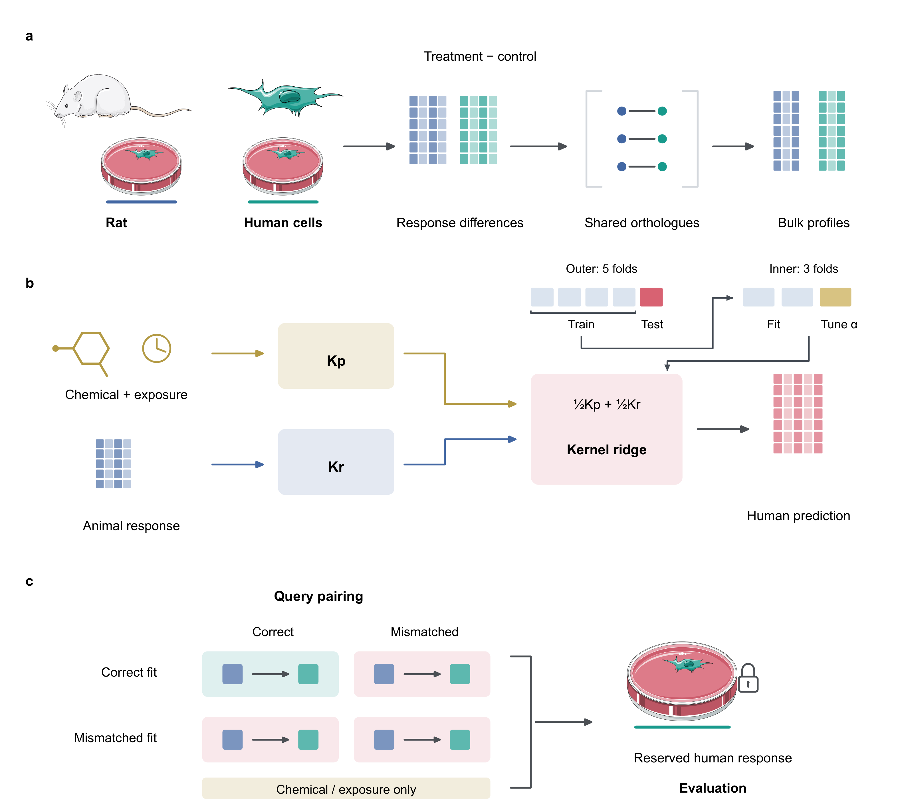
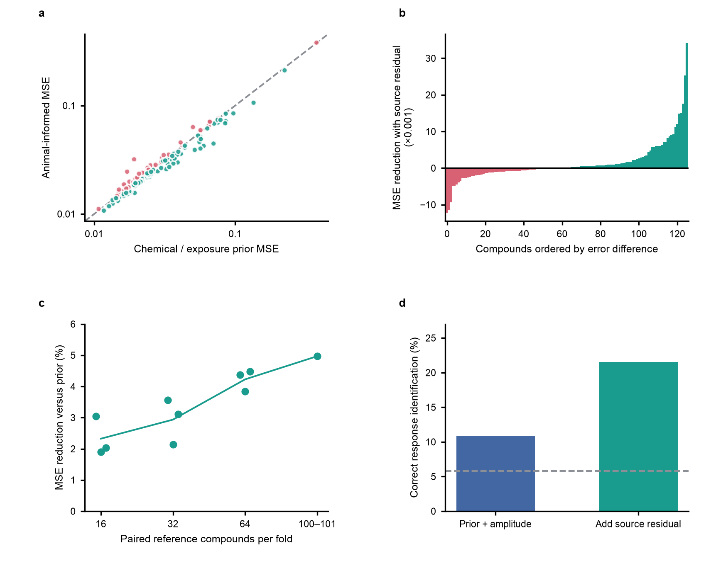
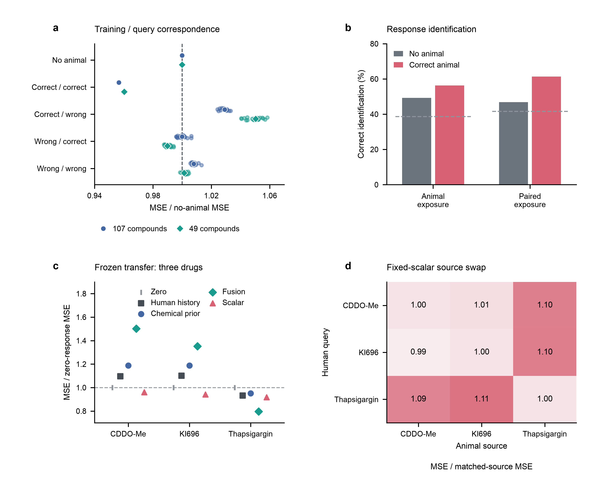
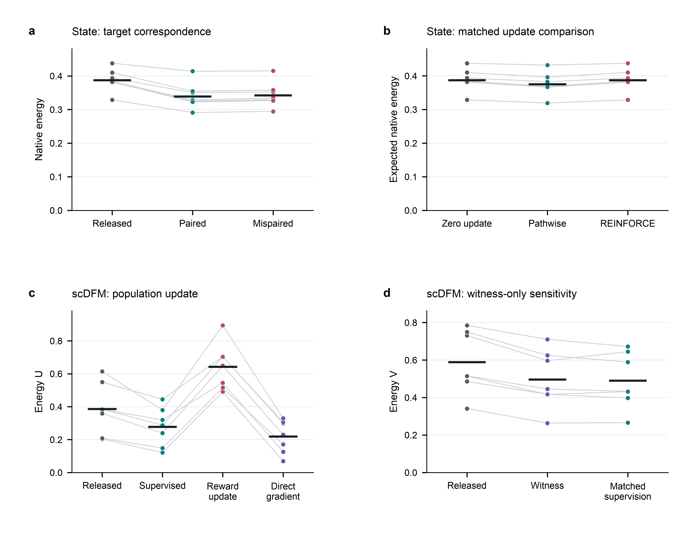
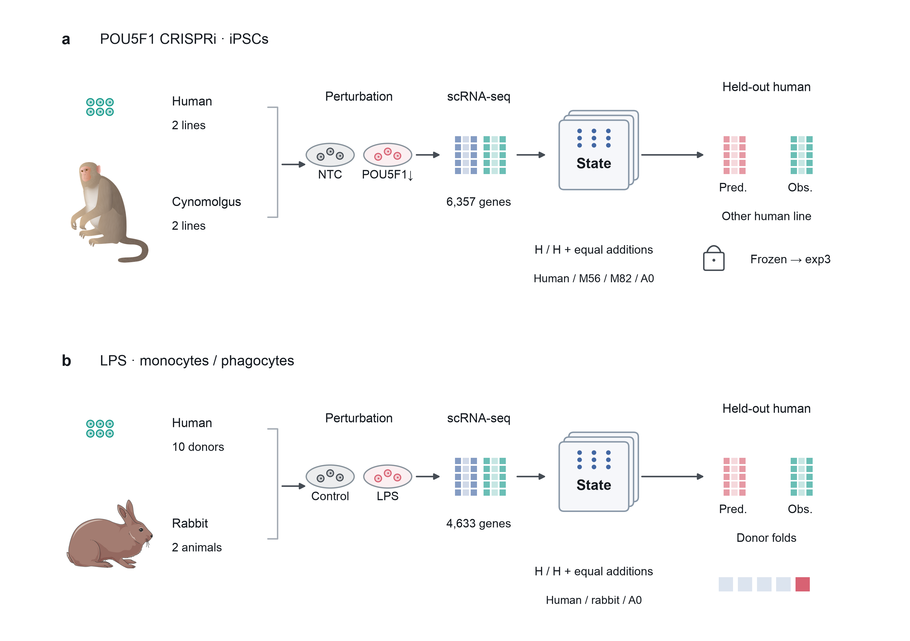
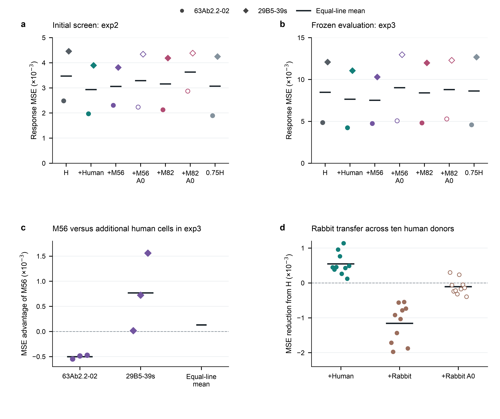

# Manuscript figures

Figures for **How animal data can improve models of human perturbation responses**.

[All six figures (PDF)](generated/paper_figures.pdf) · [Numerical verification](generated/paper_results.json) · [Figure verification](generated/figure_verification.json)

From the release directory, run:

```bash
python scripts/verify_paper_results.py --out figures/generated/paper_results.json
python scripts/reproduce_paper_figures.py --compare
```

## Figure 1 — Data and method relationships

[PDF](generated/Fig1_method.pdf) · [SVG](generated/Fig1_method.svg) · [Caption](captions/Fig1_method.md)



## Figure 2 — Predictive information in measured rat responses

[PDF](generated/Fig2_information.pdf) · [SVG](generated/Fig2_information.svg) · [Source data](generated/source_data/Fig2_information.json) · [Caption](captions/Fig2_information.md)



## Figure 3 — Correspondence and study transfer

[PDF](generated/Fig3_correspondence_transport.pdf) · [SVG](generated/Fig3_correspondence_transport.svg) · [Source data](generated/source_data/Fig3_correspondence_transport.json) · [Caption](captions/Fig3_correspondence_transport.md)



## Figure 4 — Human-only adaptation

[PDF](generated/Fig4_adaptation.pdf) · [SVG](generated/Fig4_adaptation.svg) · [Source data](generated/source_data/Fig4_adaptation.csv) · [Caption](captions/Fig4_adaptation.md)



## Figure 5 — Animal-training design

[PDF](generated/Fig5_augmentation_design.pdf) · [SVG](generated/Fig5_augmentation_design.svg) · [Source data](generated/source_data/) · [Caption](captions/Fig5_augmentation_design.md)



## Figure 6 — Animal-training results

[PDF](generated/Fig6_augmentation_results.pdf) · [SVG](generated/Fig6_augmentation_results.svg) · [Source data](generated/source_data/) · [Caption](captions/Fig6_augmentation_results.md)



## Artwork credits

Figure 1 includes rat, culture-dish and cell artwork adapted from [Servier Medical Art](https://smart.servier.com/) under [CC BY 3.0](https://creativecommons.org/licenses/by/3.0/). Colors, scale and layout were modified.

Figure 5 uses generic macaque artwork by [DBCLS](https://raw.githubusercontent.com/duerrsimon/bioicons/d29e766ea7580b8063c4f47b29e872db40a4d979/static/icons/cc-by-4.0/Animals/DBCLS/Rhesus_monkey.svg) under [CC BY 4.0](https://creativecommons.org/licenses/by/4.0/) and rabbit artwork by [Servier Medical Art](https://smart.servier.com/) under [CC BY 3.0](https://creativecommons.org/licenses/by/3.0/), scaled and positioned in the study schematic. Asset URLs, licenses and checksums are recorded in [assets/sources.json](assets/sources.json).
